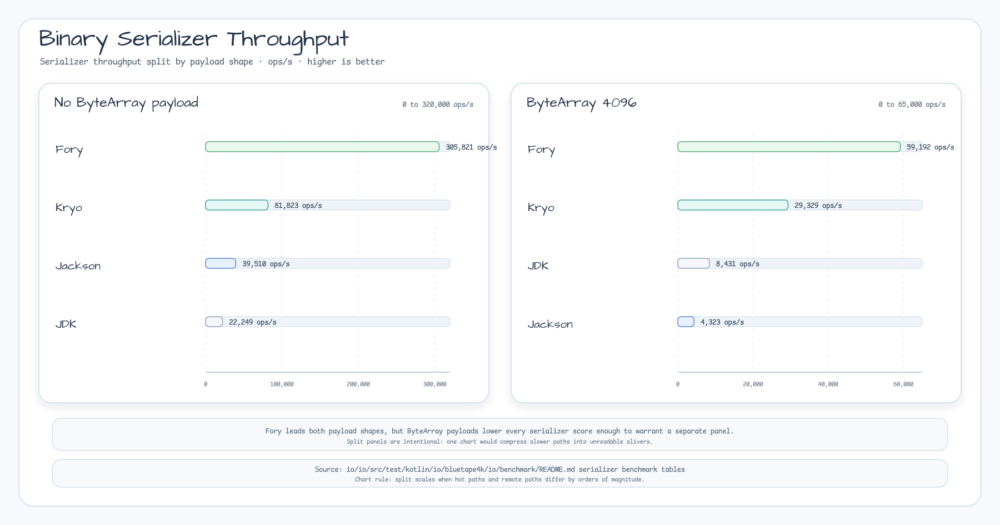
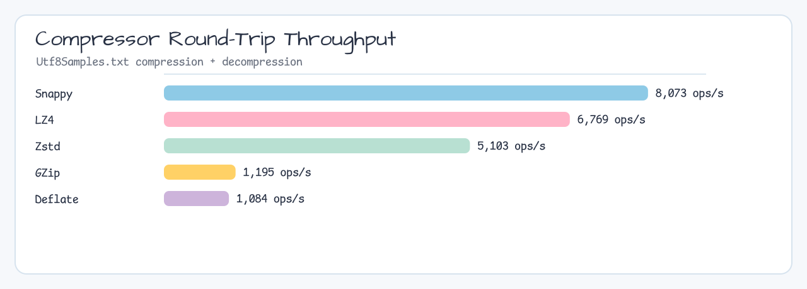

# Benchmark 결과

## Binary Serializers

직렬화 할 대상은 다음과 같은 단순한 data class 에 랜덤한 값을 주입하고, 20개의 컬렉션을 직렬화/역직렬화 하는 작업에 대한 성능테스트입니다.

```kotlin
data class SimpleData(
    val id: Long,
    val name: String,
    val age: Int,
    val birth: LocalDate,
    val biography: String,
    val zip: String,
    val address: String,
    val price: BigDecimal? = null,
    val uuid: UUID? = null,         // NOTE: Kryo 는 JDK에 따라 UUID 를 지원하지 않을 수 있음 
    val bytes: ByteArray? = null,
): Serializable
```

### Byte Array 가 없는 경우

1. Byte Array 속성에 값이 없는 경우

| Library | ops/s   |
|---------|---------|
| Fory    | 305,821 |
| kryo    | 81,823  |
| jdk     | 22,249  |
| jackson | 39,510  |

> Fory 가 홍보하는 정도까지는 아니지만, 기존에 가장 많이 사용하는 Kryo 보다 3배 이상 빠르다.
> 단순 수형에 대한 처리는 의외로 JDK 가 가장 느리다.
>

2. Byte Array 에 랜덤한 4096 바이트를 넣은 경우

| Library | ops/s  |
|---------|--------|
| Fory    | 59,192 |
| kryo    | 29,329 |
| jdk     | 8,431  |
| jackson | 4,323  |



> Fory 가 홍보하는 정도까지는 아니지만, 기존에 가장 많이 사용하는 Kryo 보다 3배 이상 빠르다.
> ByteArray 직렬화 하는 경우, Jackson 이 가장 느리다.

## Compressor

resources/files/Utf8Samples.txt (40kb) 파일을 압축/복원 성능 테스트

| Compressor | ops/s |
|------------|-------|
| gzip       | 1,195 |
| deflate    | 1,084 |
| lz4        | 6,769 |
| snappy     | 8,073 |
| zstd       | 5,103 |



## SHA-256 다이제스트 특성 측정 (2026-11-24)

이 결과는 단일 thread의 raw-digest microbenchmark 기록이다. Workshop 소비자 성능, API 간 우열, 성능 향상이나 회귀를 주장하지 않는다.

- 실행 명령: `./gradlew -Didea.active=false :bluetape4k-io:testDigestBenchmark --console=plain`
- Git HEAD: `ac67509466d88f348725be9dcf45eb9a4cb2d369`
- `DigestBenchmark.kt` SHA-256: `61796235ba9c9549cd90f5f753495b1a2a6786e0cde9ec12fb4f2955e113459e`
- Gradle Wrapper `9.8.2`, Kotlin `2.4.10`, kotlinx-benchmark `0.4.17`, JMH `1.37`
- JDK: Oracle GraalVM `25.0.5.0.3+1-LTS-jvmci-25.5-b26`; VM `Java HotSpot(TM) 64-Bit Server VM`
- OS/kernel/architecture: macOS `27.2.1`, Darwin kernel `27.2.0`, `arm64`
- CPU: Apple M4 Pro, 12 logical cores
- JMH fork JVM arguments: `-XX:ThreadPriorityPolicy=1 -XX:+UnlockExperimentalVMOptions -XX:+EnableJVMCIProduct -XX:+EnableJVMCI -XX:-UnlockExperimentalVMOptions -Dfile.encoding=UTF-8 -Duser.country=KR -Duser.language=ko -Duser.variant`
- 구성: throughput (`ops/s`), 2 forks, fork당 warmup 2회 × 1초, 측정 5회 × 1초, 1 thread. 모든 행의 `Cnt=10`은 두 fork의 측정 표본을 합친 값이다. 오차는 JMH의 99.9% confidence error다.
- 입력 payload: `ByteArray(size) { index -> ((index * 31 + size) % 256).toByte() }`

| 크기 | Payload SHA-256 |
|---:|---|
| 64 B | `3ea97ec766b8247739939247b4d4cb362cf13c100deb0cc2ba5391f762023852` |
| 1 KiB | `b54e72e83904b84eb645c6c4b7a55f73b85871cdc9a74645979cd7c1be411b40` |
| 64 KiB | `58f414c587d599b6fa1678097a7459ce669c6e0fe894d81be9c7ed2879bd6bcb` |

| 경로 | 측정 구간 |
|---|---|
| `jdkOneShot` | timed method 안의 `MessageDigest.getInstance("SHA-256")` 생성과 digest |
| `apiOneShot` | `Digesters.SHA256.digest(payload)`; 호출마다 새 session 생성 포함 |
| `apiIncrementalNewSession` | 새 session 생성, 두 조각 `update`, `digest` |
| `apiIncrementalReusedSession` | Trial setup에서 생성한 thread-local session의 두 조각 `update`와 `digest`; session 생성 제외 |

| 경로 | 크기 | Score ± error (ops/s) |
|---|---:|---:|
| `apiIncrementalNewSession` | 64 B | 17,411,018.703 ± 196,067.630 |
| `apiIncrementalNewSession` | 1 KiB | 2,818,051.003 ± 117,629.295 |
| `apiIncrementalNewSession` | 64 KiB | 49,141.668 ± 3,081.972 |
| `apiIncrementalReusedSession` | 64 B | 22,941,258.662 ± 2,328,594.442 |
| `apiIncrementalReusedSession` | 1 KiB | 2,995,157.612 ± 113,938.986 |
| `apiIncrementalReusedSession` | 64 KiB | 45,320.679 ± 11,382.702 |
| `apiOneShot` | 64 B | 17,927,041.250 ± 245,311.512 |
| `apiOneShot` | 1 KiB | 2,716,333.307 ± 251,808.329 |
| `apiOneShot` | 64 KiB | 49,184.812 ± 1,980.722 |
| `jdkOneShot` | 64 B | 18,090,278.366 ± 92,067.341 |
| `jdkOneShot` | 1 KiB | 2,815,549.187 ± 75,455.891 |
| `jdkOneShot` | 64 KiB | 49,333.824 ± 1,487.594 |

처음 task 실행은 plugin 기본 `jvmForks=1`이 class의 `@Fork(2)`를 덮어써서 측정 기준을 충족하지 못했다. 해당 수치는 채택하지 않았다. named `digest` configuration에 `advanced("jvmForks", "definedByJmh")`를 설정한 뒤 재실행했고, 결과 JSON에서 12개 조합 각각 `forks=2`, fork별 5개 측정값을 확인했다. JMH 1.37은 JDK 25에서 `sun.misc.Unsafe.objectFieldOffset`의 terminal deprecation warning을 출력했으며 task는 성공했다.

아래는 최종 실행이 생성한 JMH JSON report 전체다. fork별 원시 측정값과 실행 환경을 포함한다.

```json
[
    {
        "jmhVersion" : "1.37",
        "benchmark" : "io.bluetape4k.io.benchmark.DigestBenchmark.apiIncrementalNewSession",
        "mode" : "thrpt",
        "threads" : 1,
        "forks" : 2,
        "jvm" : "/Library/Java/JavaVirtualMachines/graalvm-jdk-25/Contents/Home/bin/java",
        "jvmArgs" : [
            "-XX:ThreadPriorityPolicy=1",
            "-XX:+UnlockExperimentalVMOptions",
            "-XX:+EnableJVMCIProduct",
            "-XX:+EnableJVMCI",
            "-XX:-UnlockExperimentalVMOptions",
            "-Dfile.encoding=UTF-8",
            "-Duser.country=KR",
            "-Duser.language=ko",
            "-Duser.variant"
        ],
        "jdkVersion" : "25.0.5.0.3",
        "vmName" : "Java HotSpot(TM) 64-Bit Server VM",
        "vmVersion" : "25.0.5.0.3+1-LTS-jvmci-25.5-b26",
        "warmupIterations" : 2,
        "warmupTime" : "1 s",
        "warmupBatchSize" : 1,
        "measurementIterations" : 5,
        "measurementTime" : "1 s",
        "measurementBatchSize" : 1,
        "params" : {
            "payloadSize" : "64"
        },
        "primaryMetric" : {
            "score" : 17411018.70282546,
            "scoreError" : 196067.62956701952,
            "scoreConfidence" : [
                17214951.07325844,
                17607086.33239248
            ],
            "scorePercentiles" : {
                "0.0" : 17124456.560454935,
                "50.0" : 17458511.191684216,
                "90.0" : 17521212.586070355,
                "95.0" : 17521585.268396743,
                "99.0" : 17521585.268396743,
                "99.9" : 17521585.268396743,
                "99.99" : 17521585.268396743,
                "99.999" : 17521585.268396743,
                "99.9999" : 17521585.268396743,
                "100.0" : 17521585.268396743
            },
            "scoreUnit" : "ops/s",
            "rawData" : [
                [
                    17345557.04837189,
                    17438610.298072387,
                    17512772.71651138,
                    17282305.411628243,
                    17502980.379183512
                ],
                [
                    17521585.268396743,
                    17517858.445132878,
                    17478412.085296046,
                    17385648.815206584,
                    17124456.560454935
                ]
            ]
        },
        "secondaryMetrics" : {}
    },
    {
        "jmhVersion" : "1.37",
        "benchmark" : "io.bluetape4k.io.benchmark.DigestBenchmark.apiIncrementalNewSession",
        "mode" : "thrpt",
        "threads" : 1,
        "forks" : 2,
        "jvm" : "/Library/Java/JavaVirtualMachines/graalvm-jdk-25/Contents/Home/bin/java",
        "jvmArgs" : [
            "-XX:ThreadPriorityPolicy=1",
            "-XX:+UnlockExperimentalVMOptions",
            "-XX:+EnableJVMCIProduct",
            "-XX:+EnableJVMCI",
            "-XX:-UnlockExperimentalVMOptions",
            "-Dfile.encoding=UTF-8",
            "-Duser.country=KR",
            "-Duser.language=ko",
            "-Duser.variant"
        ],
        "jdkVersion" : "25.0.5.0.3",
        "vmName" : "Java HotSpot(TM) 64-Bit Server VM",
        "vmVersion" : "25.0.5.0.3+1-LTS-jvmci-25.5-b26",
        "warmupIterations" : 2,
        "warmupTime" : "1 s",
        "warmupBatchSize" : 1,
        "measurementIterations" : 5,
        "measurementTime" : "1 s",
        "measurementBatchSize" : 1,
        "params" : {
            "payloadSize" : "1024"
        },
        "primaryMetric" : {
            "score" : 2818051.0025099786,
            "scoreError" : 117629.29455618719,
            "scoreConfidence" : [
                2700421.7079537916,
                2935680.2970661656
            ],
            "scorePercentiles" : {
                "0.0" : 2687976.618792589,
                "50.0" : 2834759.3677727072,
                "90.0" : 2902884.9254024406,
                "95.0" : 2903332.836338691,
                "99.0" : 2903332.836338691,
                "99.9" : 2903332.836338691,
                "99.99" : 2903332.836338691,
                "99.999" : 2903332.836338691,
                "99.9999" : 2903332.836338691,
                "100.0" : 2903332.836338691
            },
            "scoreUnit" : "ops/s",
            "rawData" : [
                [
                    2903332.836338691,
                    2777625.9775979845,
                    2715523.6750968774,
                    2843361.12066026,
                    2878835.725862776
                ],
                [
                    2826157.6148851546,
                    2884137.9372524624,
                    2898853.7269761893,
                    2687976.618792589,
                    2764704.7916368004
                ]
            ]
        },
        "secondaryMetrics" : {}
    },
    {
        "jmhVersion" : "1.37",
        "benchmark" : "io.bluetape4k.io.benchmark.DigestBenchmark.apiIncrementalNewSession",
        "mode" : "thrpt",
        "threads" : 1,
        "forks" : 2,
        "jvm" : "/Library/Java/JavaVirtualMachines/graalvm-jdk-25/Contents/Home/bin/java",
        "jvmArgs" : [
            "-XX:ThreadPriorityPolicy=1",
            "-XX:+UnlockExperimentalVMOptions",
            "-XX:+EnableJVMCIProduct",
            "-XX:+EnableJVMCI",
            "-XX:-UnlockExperimentalVMOptions",
            "-Dfile.encoding=UTF-8",
            "-Duser.country=KR",
            "-Duser.language=ko",
            "-Duser.variant"
        ],
        "jdkVersion" : "25.0.5.0.3",
        "vmName" : "Java HotSpot(TM) 64-Bit Server VM",
        "vmVersion" : "25.0.5.0.3+1-LTS-jvmci-25.5-b26",
        "warmupIterations" : 2,
        "warmupTime" : "1 s",
        "warmupBatchSize" : 1,
        "measurementIterations" : 5,
        "measurementTime" : "1 s",
        "measurementBatchSize" : 1,
        "params" : {
            "payloadSize" : "65536"
        },
        "primaryMetric" : {
            "score" : 49141.66826229596,
            "scoreError" : 3081.971673790157,
            "scoreConfidence" : [
                46059.69658850581,
                52223.63993608612
            ],
            "scorePercentiles" : {
                "0.0" : 45746.284697607,
                "50.0" : 49725.38149390379,
                "90.0" : 51081.65091825107,
                "95.0" : 51084.240042125515,
                "99.0" : 51084.240042125515,
                "99.9" : 51084.240042125515,
                "99.99" : 51084.240042125515,
                "99.999" : 51084.240042125515,
                "99.9999" : 51084.240042125515,
                "100.0" : 51084.240042125515
            },
            "scoreUnit" : "ops/s",
            "rawData" : [
                [
                    47912.22954944883,
                    51058.348803381064,
                    50955.319426715534,
                    50579.08693506415,
                    51084.240042125515
                ],
                [
                    50007.93775139441,
                    49442.82523641317,
                    45746.284697607,
                    45893.127045650166,
                    48737.28313515984
                ]
            ]
        },
        "secondaryMetrics" : {}
    },
    {
        "jmhVersion" : "1.37",
        "benchmark" : "io.bluetape4k.io.benchmark.DigestBenchmark.apiIncrementalReusedSession",
        "mode" : "thrpt",
        "threads" : 1,
        "forks" : 2,
        "jvm" : "/Library/Java/JavaVirtualMachines/graalvm-jdk-25/Contents/Home/bin/java",
        "jvmArgs" : [
            "-XX:ThreadPriorityPolicy=1",
            "-XX:+UnlockExperimentalVMOptions",
            "-XX:+EnableJVMCIProduct",
            "-XX:+EnableJVMCI",
            "-XX:-UnlockExperimentalVMOptions",
            "-Dfile.encoding=UTF-8",
            "-Duser.country=KR",
            "-Duser.language=ko",
            "-Duser.variant"
        ],
        "jdkVersion" : "25.0.5.0.3",
        "vmName" : "Java HotSpot(TM) 64-Bit Server VM",
        "vmVersion" : "25.0.5.0.3+1-LTS-jvmci-25.5-b26",
        "warmupIterations" : 2,
        "warmupTime" : "1 s",
        "warmupBatchSize" : 1,
        "measurementIterations" : 5,
        "measurementTime" : "1 s",
        "measurementBatchSize" : 1,
        "params" : {
            "payloadSize" : "64"
        },
        "primaryMetric" : {
            "score" : 22941258.66217374,
            "scoreError" : 2328594.4417345733,
            "scoreConfidence" : [
                20612664.220439166,
                25269853.103908315
            ],
            "scorePercentiles" : {
                "0.0" : 20470902.426082697,
                "50.0" : 23502948.236531597,
                "90.0" : 24294425.687010266,
                "95.0" : 24294969.94175344,
                "99.0" : 24294969.94175344,
                "99.9" : 24294969.94175344,
                "99.99" : 24294969.94175344,
                "99.999" : 24294969.94175344,
                "99.9999" : 24294969.94175344,
                "100.0" : 24294969.94175344
            },
            "scoreUnit" : "ops/s",
            "rawData" : [
                [
                    24294969.94175344,
                    24258735.02925922,
                    24289527.39432169,
                    24096733.949557755,
                    20531936.16365226
                ],
                [
                    21809552.50617999,
                    22646552.860865567,
                    24104513.826559342,
                    22909162.523505438,
                    20470902.426082697
                ]
            ]
        },
        "secondaryMetrics" : {}
    },
    {
        "jmhVersion" : "1.37",
        "benchmark" : "io.bluetape4k.io.benchmark.DigestBenchmark.apiIncrementalReusedSession",
        "mode" : "thrpt",
        "threads" : 1,
        "forks" : 2,
        "jvm" : "/Library/Java/JavaVirtualMachines/graalvm-jdk-25/Contents/Home/bin/java",
        "jvmArgs" : [
            "-XX:ThreadPriorityPolicy=1",
            "-XX:+UnlockExperimentalVMOptions",
            "-XX:+EnableJVMCIProduct",
            "-XX:+EnableJVMCI",
            "-XX:-UnlockExperimentalVMOptions",
            "-Dfile.encoding=UTF-8",
            "-Duser.country=KR",
            "-Duser.language=ko",
            "-Duser.variant"
        ],
        "jdkVersion" : "25.0.5.0.3",
        "vmName" : "Java HotSpot(TM) 64-Bit Server VM",
        "vmVersion" : "25.0.5.0.3+1-LTS-jvmci-25.5-b26",
        "warmupIterations" : 2,
        "warmupTime" : "1 s",
        "warmupBatchSize" : 1,
        "measurementIterations" : 5,
        "measurementTime" : "1 s",
        "measurementBatchSize" : 1,
        "params" : {
            "payloadSize" : "1024"
        },
        "primaryMetric" : {
            "score" : 2995157.611620708,
            "scoreError" : 113938.98630531617,
            "scoreConfidence" : [
                2881218.625315392,
                3109096.597926024
            ],
            "scorePercentiles" : {
                "0.0" : 2829062.2451742454,
                "50.0" : 3031115.03741665,
                "90.0" : 3078506.7482214165,
                "95.0" : 3082526.6992096724,
                "99.0" : 3082526.6992096724,
                "99.9" : 3082526.6992096724,
                "99.99" : 3082526.6992096724,
                "99.999" : 3082526.6992096724,
                "99.9999" : 3082526.6992096724,
                "100.0" : 3082526.6992096724
            },
            "scoreUnit" : "ops/s",
            "rawData" : [
                [
                    2963365.6773817115,
                    3036606.7404003954,
                    3040605.430003535,
                    3036581.5198435164,
                    3082526.6992096724
                ],
                [
                    2829062.2451742454,
                    3025648.5549897836,
                    3042327.1893271133,
                    2976361.5166876526,
                    2918490.54318945
                ]
            ]
        },
        "secondaryMetrics" : {}
    },
    {
        "jmhVersion" : "1.37",
        "benchmark" : "io.bluetape4k.io.benchmark.DigestBenchmark.apiIncrementalReusedSession",
        "mode" : "thrpt",
        "threads" : 1,
        "forks" : 2,
        "jvm" : "/Library/Java/JavaVirtualMachines/graalvm-jdk-25/Contents/Home/bin/java",
        "jvmArgs" : [
            "-XX:ThreadPriorityPolicy=1",
            "-XX:+UnlockExperimentalVMOptions",
            "-XX:+EnableJVMCIProduct",
            "-XX:+EnableJVMCI",
            "-XX:-UnlockExperimentalVMOptions",
            "-Dfile.encoding=UTF-8",
            "-Duser.country=KR",
            "-Duser.language=ko",
            "-Duser.variant"
        ],
        "jdkVersion" : "25.0.5.0.3",
        "vmName" : "Java HotSpot(TM) 64-Bit Server VM",
        "vmVersion" : "25.0.5.0.3+1-LTS-jvmci-25.5-b26",
        "warmupIterations" : 2,
        "warmupTime" : "1 s",
        "warmupBatchSize" : 1,
        "measurementIterations" : 5,
        "measurementTime" : "1 s",
        "measurementBatchSize" : 1,
        "params" : {
            "payloadSize" : "65536"
        },
        "primaryMetric" : {
            "score" : 45320.679275405986,
            "scoreError" : 11382.702237215433,
            "scoreConfidence" : [
                33937.977038190555,
                56703.38151262142
            ],
            "scorePercentiles" : {
                "0.0" : 26105.12332031878,
                "50.0" : 48995.842848594344,
                "90.0" : 49763.25552169941,
                "95.0" : 49807.64249658469,
                "99.0" : 49807.64249658469,
                "99.9" : 49807.64249658469,
                "99.99" : 49807.64249658469,
                "99.999" : 49807.64249658469,
                "99.9999" : 49807.64249658469,
                "100.0" : 49807.64249658469
            },
            "scoreUnit" : "ops/s",
            "rawData" : [
                [
                    49807.64249658469,
                    39059.61624641078,
                    26105.12332031878,
                    44469.792101426094,
                    48845.0210732886
                ],
                [
                    47954.333010100105,
                    49183.9032036503,
                    49270.92393064856,
                    49146.664623900084,
                    49363.772747731884
                ]
            ]
        },
        "secondaryMetrics" : {}
    },
    {
        "jmhVersion" : "1.37",
        "benchmark" : "io.bluetape4k.io.benchmark.DigestBenchmark.apiOneShot",
        "mode" : "thrpt",
        "threads" : 1,
        "forks" : 2,
        "jvm" : "/Library/Java/JavaVirtualMachines/graalvm-jdk-25/Contents/Home/bin/java",
        "jvmArgs" : [
            "-XX:ThreadPriorityPolicy=1",
            "-XX:+UnlockExperimentalVMOptions",
            "-XX:+EnableJVMCIProduct",
            "-XX:+EnableJVMCI",
            "-XX:-UnlockExperimentalVMOptions",
            "-Dfile.encoding=UTF-8",
            "-Duser.country=KR",
            "-Duser.language=ko",
            "-Duser.variant"
        ],
        "jdkVersion" : "25.0.5.0.3",
        "vmName" : "Java HotSpot(TM) 64-Bit Server VM",
        "vmVersion" : "25.0.5.0.3+1-LTS-jvmci-25.5-b26",
        "warmupIterations" : 2,
        "warmupTime" : "1 s",
        "warmupBatchSize" : 1,
        "measurementIterations" : 5,
        "measurementTime" : "1 s",
        "measurementBatchSize" : 1,
        "params" : {
            "payloadSize" : "64"
        },
        "primaryMetric" : {
            "score" : 17927041.250013944,
            "scoreError" : 245311.51225117932,
            "scoreConfidence" : [
                17681729.737762764,
                18172352.762265123
            ],
            "scorePercentiles" : {
                "0.0" : 17650760.617721435,
                "50.0" : 18017494.236745685,
                "90.0" : 18078392.923118845,
                "95.0" : 18080697.84736438,
                "99.0" : 18080697.84736438,
                "99.9" : 18080697.84736438,
                "99.99" : 18080697.84736438,
                "99.999" : 18080697.84736438,
                "99.9999" : 18080697.84736438,
                "100.0" : 18080697.84736438
            },
            "scoreUnit" : "ops/s",
            "rawData" : [
                [
                    18080697.84736438,
                    17693651.0811394,
                    17770941.12929153,
                    18043691.204079367,
                    17907426.273378816
                ],
                [
                    17650760.617721435,
                    18013568.383090436,
                    18021420.09040093,
                    18057648.60490901,
                    18030607.268764134
                ]
            ]
        },
        "secondaryMetrics" : {}
    },
    {
        "jmhVersion" : "1.37",
        "benchmark" : "io.bluetape4k.io.benchmark.DigestBenchmark.apiOneShot",
        "mode" : "thrpt",
        "threads" : 1,
        "forks" : 2,
        "jvm" : "/Library/Java/JavaVirtualMachines/graalvm-jdk-25/Contents/Home/bin/java",
        "jvmArgs" : [
            "-XX:ThreadPriorityPolicy=1",
            "-XX:+UnlockExperimentalVMOptions",
            "-XX:+EnableJVMCIProduct",
            "-XX:+EnableJVMCI",
            "-XX:-UnlockExperimentalVMOptions",
            "-Dfile.encoding=UTF-8",
            "-Duser.country=KR",
            "-Duser.language=ko",
            "-Duser.variant"
        ],
        "jdkVersion" : "25.0.5.0.3",
        "vmName" : "Java HotSpot(TM) 64-Bit Server VM",
        "vmVersion" : "25.0.5.0.3+1-LTS-jvmci-25.5-b26",
        "warmupIterations" : 2,
        "warmupTime" : "1 s",
        "warmupBatchSize" : 1,
        "measurementIterations" : 5,
        "measurementTime" : "1 s",
        "measurementBatchSize" : 1,
        "params" : {
            "payloadSize" : "1024"
        },
        "primaryMetric" : {
            "score" : 2716333.3071491728,
            "scoreError" : 251808.3285753679,
            "scoreConfidence" : [
                2464524.9785738047,
                2968141.635724541
            ],
            "scorePercentiles" : {
                "0.0" : 2270465.2942456407,
                "50.0" : 2781284.609724168,
                "90.0" : 2831151.8981361603,
                "95.0" : 2832145.882709045,
                "99.0" : 2832145.882709045,
                "99.9" : 2832145.882709045,
                "99.99" : 2832145.882709045,
                "99.999" : 2832145.882709045,
                "99.9999" : 2832145.882709045,
                "100.0" : 2832145.882709045
            },
            "scoreUnit" : "ops/s",
            "rawData" : [
                [
                    2659577.3065563296,
                    2270465.2942456407,
                    2684547.5173661015,
                    2739246.5864691436,
                    2784979.619965453
                ],
                [
                    2785322.5961007616,
                    2807252.631616172,
                    2777589.5994828832,
                    2822206.0369802,
                    2832145.882709045
                ]
            ]
        },
        "secondaryMetrics" : {}
    },
    {
        "jmhVersion" : "1.37",
        "benchmark" : "io.bluetape4k.io.benchmark.DigestBenchmark.apiOneShot",
        "mode" : "thrpt",
        "threads" : 1,
        "forks" : 2,
        "jvm" : "/Library/Java/JavaVirtualMachines/graalvm-jdk-25/Contents/Home/bin/java",
        "jvmArgs" : [
            "-XX:ThreadPriorityPolicy=1",
            "-XX:+UnlockExperimentalVMOptions",
            "-XX:+EnableJVMCIProduct",
            "-XX:+EnableJVMCI",
            "-XX:-UnlockExperimentalVMOptions",
            "-Dfile.encoding=UTF-8",
            "-Duser.country=KR",
            "-Duser.language=ko",
            "-Duser.variant"
        ],
        "jdkVersion" : "25.0.5.0.3",
        "vmName" : "Java HotSpot(TM) 64-Bit Server VM",
        "vmVersion" : "25.0.5.0.3+1-LTS-jvmci-25.5-b26",
        "warmupIterations" : 2,
        "warmupTime" : "1 s",
        "warmupBatchSize" : 1,
        "measurementIterations" : 5,
        "measurementTime" : "1 s",
        "measurementBatchSize" : 1,
        "params" : {
            "payloadSize" : "65536"
        },
        "primaryMetric" : {
            "score" : 49184.81228489446,
            "scoreError" : 1980.722291546118,
            "scoreConfidence" : [
                47204.089993348345,
                51165.53457644058
            ],
            "scorePercentiles" : {
                "0.0" : 46603.54807045184,
                "50.0" : 49683.1779706987,
                "90.0" : 50153.03061700533,
                "95.0" : 50155.01171495691,
                "99.0" : 50155.01171495691,
                "99.9" : 50155.01171495691,
                "99.99" : 50155.01171495691,
                "99.999" : 50155.01171495691,
                "99.9999" : 50155.01171495691,
                "100.0" : 50155.01171495691
            },
            "scoreUnit" : "ops/s",
            "rawData" : [
                [
                    49420.52068366803,
                    50155.01171495691,
                    50135.20073544108,
                    49856.4947682648,
                    49711.64035864239
                ],
                [
                    49654.71558275501,
                    46603.54807045184,
                    46880.08179626296,
                    49541.696930239326,
                    49889.21220826238
                ]
            ]
        },
        "secondaryMetrics" : {}
    },
    {
        "jmhVersion" : "1.37",
        "benchmark" : "io.bluetape4k.io.benchmark.DigestBenchmark.jdkOneShot",
        "mode" : "thrpt",
        "threads" : 1,
        "forks" : 2,
        "jvm" : "/Library/Java/JavaVirtualMachines/graalvm-jdk-25/Contents/Home/bin/java",
        "jvmArgs" : [
            "-XX:ThreadPriorityPolicy=1",
            "-XX:+UnlockExperimentalVMOptions",
            "-XX:+EnableJVMCIProduct",
            "-XX:+EnableJVMCI",
            "-XX:-UnlockExperimentalVMOptions",
            "-Dfile.encoding=UTF-8",
            "-Duser.country=KR",
            "-Duser.language=ko",
            "-Duser.variant"
        ],
        "jdkVersion" : "25.0.5.0.3",
        "vmName" : "Java HotSpot(TM) 64-Bit Server VM",
        "vmVersion" : "25.0.5.0.3+1-LTS-jvmci-25.5-b26",
        "warmupIterations" : 2,
        "warmupTime" : "1 s",
        "warmupBatchSize" : 1,
        "measurementIterations" : 5,
        "measurementTime" : "1 s",
        "measurementBatchSize" : 1,
        "params" : {
            "payloadSize" : "64"
        },
        "primaryMetric" : {
            "score" : 18090278.366189074,
            "scoreError" : 92067.34132957713,
            "scoreConfidence" : [
                17998211.024859495,
                18182345.707518652
            ],
            "scorePercentiles" : {
                "0.0" : 17965531.471068934,
                "50.0" : 18098956.430126805,
                "90.0" : 18159839.22707715,
                "95.0" : 18160633.11683952,
                "99.0" : 18160633.11683952,
                "99.9" : 18160633.11683952,
                "99.99" : 18160633.11683952,
                "99.999" : 18160633.11683952,
                "99.9999" : 18160633.11683952,
                "100.0" : 18160633.11683952
            },
            "scoreUnit" : "ops/s",
            "rawData" : [
                [
                    17965531.471068934,
                    18098340.416521408,
                    18099353.076100003,
                    18021200.28626269,
                    18055020.75377389
                ],
                [
                    18160633.11683952,
                    18136325.73867004,
                    18098559.784153607,
                    18152694.21921581,
                    18115124.799284853
                ]
            ]
        },
        "secondaryMetrics" : {}
    },
    {
        "jmhVersion" : "1.37",
        "benchmark" : "io.bluetape4k.io.benchmark.DigestBenchmark.jdkOneShot",
        "mode" : "thrpt",
        "threads" : 1,
        "forks" : 2,
        "jvm" : "/Library/Java/JavaVirtualMachines/graalvm-jdk-25/Contents/Home/bin/java",
        "jvmArgs" : [
            "-XX:ThreadPriorityPolicy=1",
            "-XX:+UnlockExperimentalVMOptions",
            "-XX:+EnableJVMCIProduct",
            "-XX:+EnableJVMCI",
            "-XX:-UnlockExperimentalVMOptions",
            "-Dfile.encoding=UTF-8",
            "-Duser.country=KR",
            "-Duser.language=ko",
            "-Duser.variant"
        ],
        "jdkVersion" : "25.0.5.0.3",
        "vmName" : "Java HotSpot(TM) 64-Bit Server VM",
        "vmVersion" : "25.0.5.0.3+1-LTS-jvmci-25.5-b26",
        "warmupIterations" : 2,
        "warmupTime" : "1 s",
        "warmupBatchSize" : 1,
        "measurementIterations" : 5,
        "measurementTime" : "1 s",
        "measurementBatchSize" : 1,
        "params" : {
            "payloadSize" : "1024"
        },
        "primaryMetric" : {
            "score" : 2815549.1868445612,
            "scoreError" : 75455.89064064264,
            "scoreConfidence" : [
                2740093.2962039188,
                2891005.0774852037
            ],
            "scorePercentiles" : {
                "0.0" : 2701667.0928711477,
                "50.0" : 2837257.872520907,
                "90.0" : 2855168.409579206,
                "95.0" : 2855228.278348765,
                "99.0" : 2855228.278348765,
                "99.9" : 2855228.278348765,
                "99.99" : 2855228.278348765,
                "99.999" : 2855228.278348765,
                "99.9999" : 2855228.278348765,
                "100.0" : 2855228.278348765
            },
            "scoreUnit" : "ops/s",
            "rawData" : [
                [
                    2701667.0928711477,
                    2783048.9827723457,
                    2835620.330249792,
                    2838895.4147920217,
                    2849742.04530495
                ],
                [
                    2830452.666675432,
                    2854629.5906531746,
                    2855228.278348765,
                    2766754.801424043,
                    2839452.6653539427
                ]
            ]
        },
        "secondaryMetrics" : {}
    },
    {
        "jmhVersion" : "1.37",
        "benchmark" : "io.bluetape4k.io.benchmark.DigestBenchmark.jdkOneShot",
        "mode" : "thrpt",
        "threads" : 1,
        "forks" : 2,
        "jvm" : "/Library/Java/JavaVirtualMachines/graalvm-jdk-25/Contents/Home/bin/java",
        "jvmArgs" : [
            "-XX:ThreadPriorityPolicy=1",
            "-XX:+UnlockExperimentalVMOptions",
            "-XX:+EnableJVMCIProduct",
            "-XX:+EnableJVMCI",
            "-XX:-UnlockExperimentalVMOptions",
            "-Dfile.encoding=UTF-8",
            "-Duser.country=KR",
            "-Duser.language=ko",
            "-Duser.variant"
        ],
        "jdkVersion" : "25.0.5.0.3",
        "vmName" : "Java HotSpot(TM) 64-Bit Server VM",
        "vmVersion" : "25.0.5.0.3+1-LTS-jvmci-25.5-b26",
        "warmupIterations" : 2,
        "warmupTime" : "1 s",
        "warmupBatchSize" : 1,
        "measurementIterations" : 5,
        "measurementTime" : "1 s",
        "measurementBatchSize" : 1,
        "params" : {
            "payloadSize" : "65536"
        },
        "primaryMetric" : {
            "score" : 49333.82418611548,
            "scoreError" : 1487.5938029340905,
            "scoreConfidence" : [
                47846.23038318139,
                50821.41798904957
            ],
            "scorePercentiles" : {
                "0.0" : 47937.91692267521,
                "50.0" : 49853.38799446271,
                "90.0" : 50385.3435001448,
                "95.0" : 50414.78940746881,
                "99.0" : 50414.78940746881,
                "99.9" : 50414.78940746881,
                "99.99" : 50414.78940746881,
                "99.999" : 50414.78940746881,
                "99.9999" : 50414.78940746881,
                "100.0" : 50414.78940746881
            },
            "scoreUnit" : "ops/s",
            "rawData" : [
                [
                    49642.04468424641,
                    50120.33033422874,
                    50103.63901642566,
                    48185.58968599304,
                    47937.91692267521
                ],
                [
                    48117.93586740983,
                    50064.731304679015,
                    50414.78940746881,
                    50066.878326919665,
                    48684.38631110839
                ]
            ]
        },
        "secondaryMetrics" : {}
    }
]
```
