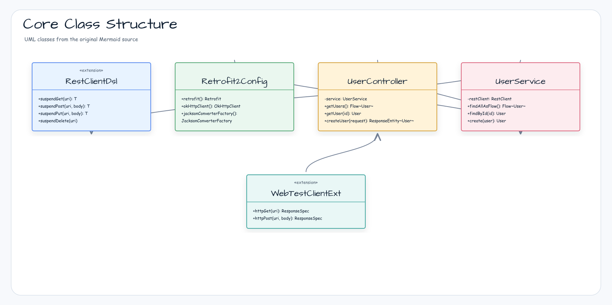
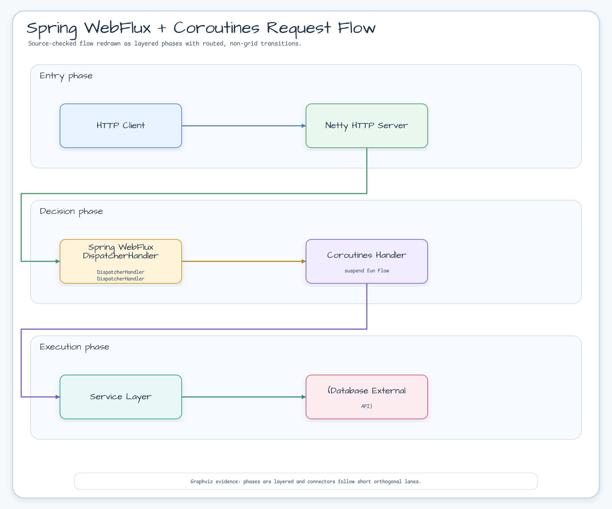
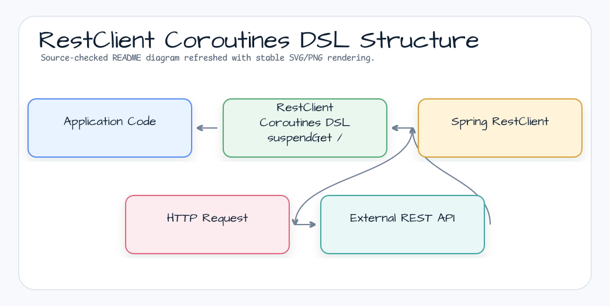
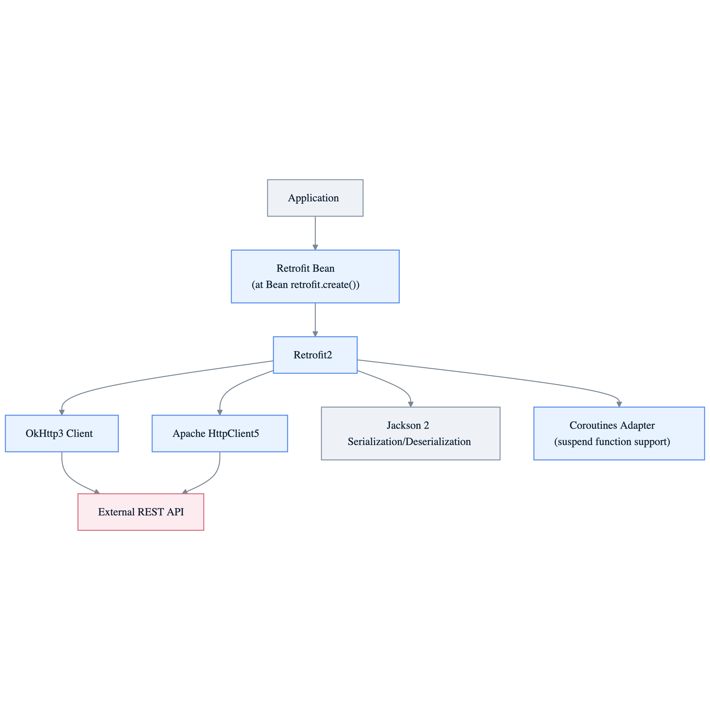

# Module bluetape4k-spring-boot-core

[English](./README.md) | 한국어

Spring Boot 4.x 기반 공통 기능 통합 모듈입니다.

> Spring Boot 4 기반 versionless 표준 구현입니다.

## 제공 기능

### Spring Core 유틸리티

- BeanFactory 확장 함수
- `AnnotatedElementUtils`와 `AnnotationUtils`를 위한 Kotlin reified 애너테이션 조회 확장
- Spring Boot AutoConfiguration 지원
- Jakarta Annotation API 통합

### Spring WebFlux + Coroutines

- Coroutines 기반 WebFlux 핸들러 유틸리티
- `WebClient` 확장 함수 (`httpGet`, `httpPost`, `httpPut`, `httpPatch`, `httpDelete`)
- `WebTestClient` 확장 함수
- Reactor ↔ Coroutines 변환 지원
- `AbstractWebClientConfig` 기반 전용 `WebClient` 리소스 구성

### RestClient Coroutines DSL

- `RestClient` 코루틴 확장 (`suspendGet`, `suspendPost`, `suspendPut`, `suspendPatch`, `suspendDelete`)

### Spring Boot Observability 헬퍼

- 서비스, HTTP 핸들러, 이벤트 핸들러 코드 경로를 위한 `ObservationRegistry.observeSpring`
- 코루틴 Observation scope 전파와 정리를 위한 `ObservationRegistry.observeSpringSuspending`
- `SpringObservationKeyValues`를 통한 Micrometer low-cardinality/high-cardinality key value 그룹화
- Prometheus와 OpenTelemetry export는 애플리케이션 소유의 Spring Boot Actuator 설정으로 유지

### MDC TaskDecorator

- 재사용 Spring worker에 caller의 불변 MDC 복사본을 전달하는 `MdcTaskDecorator`
- caller context가 비어 있으면 task 실행 중 worker MDC를 비우고, 성공·실패 후 worker의 이전 전체 map 복원
- executor 생성·종료와 Spring bean lifecycle은 애플리케이션이 소유

### 테스트 유틸리티

- Spring Boot Test 기반 통합 테스트 지원
- `WebTestClient` 테스트 확장 (`httpGet`, `httpPost` 등)
- Testcontainers 통합

## 다이어그램

### Spring Boot Core 기능 맵



### Spring WebFlux + Coroutines 요청 흐름



### RestClient Coroutines DSL 구조



### WebClient 전용 리소스 구성



## 설치

```kotlin
dependencies {
    implementation("io.github.bluetape4k:bluetape4k-spring-boot-core:${bluetape4kVersion}")
}
```

## BOM 적용 주의사항

Spring Boot 4 BOM은 반드시 `implementation(platform(...))` 방식으로 적용해야 합니다.
`dependencyManagement { imports { mavenBom() } }` 방식은 Kotlin Gradle Plugin과 충돌합니다.

```kotlin
// ✅ 올바른 방식
dependencies {
    implementation(platform("org.springframework.boot:spring-boot-dependencies:4.x.x"))
}

// ❌ 잘못된 방식 (KGP 빌드 실패 유발)
dependencyManagement {
    imports { mavenBom("org.springframework.boot:spring-boot-dependencies:4.x.x") }
}
```

## 사용 예시

### 애너테이션 조회 확장

```kotlin
import io.bluetape4k.spring.beans.findMergedAnnotationOrNull
import io.bluetape4k.spring.beans.hasMergedAnnotation

val mapping = method.findMergedAnnotationOrNull<RequestMapping>()
val hasMapping = method.hasMergedAnnotation<RequestMapping>()
```

### Spring reified 확장

이 Kotlin 확장은 reified 타입 매개변수를 이용해 Spring API가 요구하는 `Class<T>`를 전달한 뒤 해당 API에 위임합니다. Java의 class-token 호출도 계속 사용할 수 있습니다. 아래 예제의 receiver 객체와 애플리케이션 타입은 Spring 애플리케이션이나 테스트에서 준비합니다.

```kotlin
import io.bluetape4k.spring.boot.bind
import io.bluetape4k.spring.boot.bindOrCreate
import io.bluetape4k.spring.boot.get
import io.bluetape4k.spring.boot.getOrElse
import io.bluetape4k.spring.boot.getOrElseSupply
import io.bluetape4k.spring.boot.getOrElseThrow
import io.bluetape4k.spring.boot.isRegistered
import io.bluetape4k.spring.core.io.support.load
import io.bluetape4k.spring.context.annotation.register
import io.bluetape4k.spring.beans.getMergedRepeatableAnnotations
import io.bluetape4k.spring.beans.findAllMergedAnnotations
import io.bluetape4k.spring.core.typeDescriptorOf
import io.bluetape4k.spring.core.annotationMetadataOf
import io.bluetape4k.spring.expression.getValueAs
import io.bluetape4k.spring.tests.withUserConfiguration
import io.bluetape4k.spring.tests.withBean
import io.bluetape4k.spring.tests.autoConfigurationsOf
import org.springframework.beans.factory.config.BeanDefinitionCustomizer
import org.springframework.boot.autoconfigure.AutoConfigurations
import org.springframework.boot.test.context.runner.ApplicationContextRunner
import org.springframework.boot.test.context.runner.ReactiveWebApplicationContextRunner
import org.springframework.boot.test.context.runner.WebApplicationContextRunner
import org.springframework.core.io.support.SpringFactoriesLoader
import java.util.function.Supplier
```

```kotlin
// Binder: 기본 호출, handler 호출, nullable handler, bindOrCreate 두 형태
binder.bind<ServerProperties>("server")
binder.bind<ServerProperties>("server", bindHandler)
binder.bind<ServerProperties>("server", bindHandler = null)
binder.bindOrCreate<ServerProperties>("server")
binder.bindOrCreate<ServerProperties>("server", bindHandler)

// BootstrapContext: 조회, 기본값, 지연 기본값, 지연 예외, 등록 확인
val defaultSupplier = Supplier<ServerProperties?> { ServerProperties() }
val exceptionSupplier = Supplier<Throwable> { IllegalStateException("missing") }
bootstrapContext.get<ServerProperties>()
bootstrapContext.getOrElse<ServerProperties>(ServerProperties())
bootstrapContext.getOrElseSupply<ServerProperties>(defaultSupplier)
bootstrapContext.getOrElseThrow<ServerProperties>(exceptionSupplier)
bootstrapContext.isRegistered<ServerProperties>()

// SpringFactoriesLoader: 생략, resolver, failure handler, 둘 다, 명시적 null
val resolver = SpringFactoriesLoader.ArgumentResolver.from { _ -> null }
val failureHandler = SpringFactoriesLoader.FailureHandler { factoryType, factoryName, failure ->
    throw IllegalStateException("Failed to load ${factoryType.name} factory $factoryName", failure)
}
loader.load<TestFactory>()
loader.load<TestFactory>(argumentResolver = resolver)
loader.load<TestFactory>(failureHandler = failureHandler)
loader.load<TestFactory>(argumentResolver = resolver, failureHandler = failureHandler)
loader.load<TestFactory>(argumentResolver = null)
loader.load<TestFactory>(failureHandler = null)

// Context registry와 repeatable annotation 조회 의미
registry.register<SampleConfiguration>()
annotationElement.getMergedRepeatableAnnotations<Marker>()
annotationElement.findAllMergedAnnotations<Marker>() // 기존 find semantics

// Core type metadata와 SpEL의 네 typed overload
typeDescriptorOf<String>()
annotationMetadataOf<SampleConfiguration>()
expression.getValueAs<String>()
expression.getValueAs<String>(rootObject)
expression.getValueAs<String>(evaluationContext)
expression.getValueAs<String>(evaluationContext, rootObject)
expression.getValueAs<String>(rootObject = null)

// 세 concrete runner의 설정, 무명 bean, 이름 있는 bean, nullable 이름
ApplicationContextRunner().withUserConfiguration<SampleRunnerConfiguration>()
ApplicationContextRunner().withBean<ServiceBean> { ServiceBean() }
ApplicationContextRunner().withBean<ServiceBean>("service", BeanDefinitionCustomizer { it.setLazyInit(true) }) { ServiceBean() }
ApplicationContextRunner().withBean<ServiceBean>(name = null) { ServiceBean() }

WebApplicationContextRunner().withUserConfiguration<SampleRunnerConfiguration>()
WebApplicationContextRunner().withBean<ServiceBean> { ServiceBean() }
WebApplicationContextRunner().withBean<ServiceBean>("service", BeanDefinitionCustomizer { it.setLazyInit(true) }) { ServiceBean() }
WebApplicationContextRunner().withBean<ServiceBean>(name = null) { ServiceBean() }

ReactiveWebApplicationContextRunner().withUserConfiguration<SampleRunnerConfiguration>()
ReactiveWebApplicationContextRunner().withBean<ServiceBean> { ServiceBean() }
ReactiveWebApplicationContextRunner().withBean<ServiceBean>("service", BeanDefinitionCustomizer { it.setLazyInit(true) }) { ServiceBean() }
ReactiveWebApplicationContextRunner().withBean<ServiceBean>(name = null) { ServiceBean() }

// 단일 auto-configuration은 reified helper, 여러 타입은 Spring vararg API
ApplicationContextRunner().withConfiguration(autoConfigurationsOf<SampleAutoConfiguration>())
AutoConfigurations.of(FirstAutoConfiguration::class.java, SecondAutoConfiguration::class.java)
```

`getMergedRepeatableAnnotations<A>()`는 get semantics를 따르고, 기존 `findAllMergedAnnotations<A>()`는 요소의 계층을 검색합니다. 호출부에 맞는 검색 의미를 선택합니다. `typeDescriptorOf<T>()`는 raw class 정보만 담으므로 generic type argument는 보존하지 않습니다. `autoConfigurationsOf<T>()`는 class 하나를 받습니다. 여러 auto-configuration에는 Spring의 `AutoConfigurations.of(Class<?>...)`를 사용합니다. nullable Java overload 인자는 `bindHandler = null`, `argumentResolver = null`, `rootObject = null`, `name = null`처럼 Kotlin named argument로 전달합니다.

애플리케이션이 신뢰하는 resource와 classloader의 factory만 로드하세요. Factory 클래스 초기화와 생성자, `ArgumentResolver` callback은 코드를 실행하고 부수 효과를 일으킬 수 있습니다. 이 확장은 별도 검증이나 격리를 하지 않으며 sandbox를 제공하지 않습니다. Spring 기본 failure handler는 factory 로딩이 실패하면 예외를 던집니다. 사용자 handler가 정상 반환하면 해당 실패가 억제되어 성공적으로 생성한 factory만 담긴 일부 목록이 반환될 수 있습니다. 모든 provider가 필수라면 handler가 예외를 던지도록 하고, 누락된 provider를 선택 사항으로 둘 때만 실패를 기록·확인하면서 부분 결과를 허용하세요.

대상 버전은 Spring Boot 4.1.1과 Spring Framework 7.0.9입니다. 기존 starter가 제공하지 않는 API에 한해 해당 artifact를 소비자 의존성으로 선언합니다. 다음 의존성 구조 절의 표는 소비자 의존성을 안내하며 이 모듈의 의존성을 추가하지 않습니다. 버전은 Spring Boot BOM 또는 parent에 맞추고, 선택한 starter가 이미 제공하는 artifact는 중복 선언하지 않습니다.

### RestClient Coroutines DSL

이 DSL은 blocking `RestClient` 호출을 `runInterruptible(Dispatchers.IO)` 로 실행한다. 따라서 요청 factory가 thread interrupt를 존중하면 coroutine cancellation 이 대기 중인 client thread 를 interrupt 할 수 있다.

```kotlin
import io.bluetape4k.spring.http.*

val restClient = RestClient.create("https://api.example.com")

// suspend 함수로 HTTP 요청
val user: User = restClient.suspendGet("/users/1")
val created: User = restClient.suspendPost("/users", newUser, MediaType.APPLICATION_JSON)
val updated: User = restClient.suspendPut("/users/1", updatedUser, MediaType.APPLICATION_JSON)
restClient.suspendDelete("/users/1")
```

### WebClient 확장

```kotlin
import io.bluetape4k.spring.tests.*

val webClient = WebClient.create("https://api.example.com")

// GET 요청
val response = webClient.httpGet("/users")
    .bodyToFlux(User::class.java)
    .asFlow()

// POST 요청
val created = webClient.httpPost("/users", newUser)
    .bodyToMono(User::class.java)
    .awaitSingle()
```

### MDC TaskDecorator

애플리케이션이 소유한 executor에 `MdcTaskDecorator`를 연결합니다. `decorate`
호출 시점에 caller MDC를 캡처하고, task 실행 중 worker MDC를 대체한 뒤
`finally`에서 worker의 이전 map을 복원합니다.

```kotlin
import io.bluetape4k.spring.task.MdcTaskDecorator
import org.springframework.context.annotation.Bean
import org.springframework.context.annotation.Configuration
import org.springframework.scheduling.concurrent.ThreadPoolTaskExecutor

@Configuration(proxyBeanMethods = false)
class TaskExecutionConfiguration {
    @Bean
    fun applicationTaskExecutor(): ThreadPoolTaskExecutor =
        ThreadPoolTaskExecutor().apply {
            corePoolSize = 4
            maxPoolSize = 8
            setTaskDecorator(MdcTaskDecorator())
            initialize()
        }
}
```

decorator는 executor를 생성하거나 닫지 않으며 자동 bean을 등록하지 않습니다. caller MDC가 비어 있으면 task 실행 중 stale worker 값을 숨기고, task가 추가한 key는 이전 context를 복원할 때 제거됩니다.

### WebFlux 컨트롤러 (Coroutines)

```kotlin
@RestController
@RequestMapping("/users")
class UserController(private val service: UserService) {

    @GetMapping
    fun getUsers(): Flow<User> = service.findAllAsFlow()

    @GetMapping("/{id}")
    suspend fun getUser(@PathVariable id: Long): User =
        service.findById(id)
}
```

### 서비스, HTTP 핸들러, 이벤트 코드 관측

Spring Boot가 애플리케이션에 주입한 `ObservationRegistry`를 사용합니다. 이 헬퍼는 Micrometer Observation 라이프사이클과 코루틴 scope 정리만 담당하며 exporter를 설치하거나 전역 OpenTelemetry SDK 상태를 바꾸지 않습니다.

```kotlin
import io.bluetape4k.spring.observability.SpringObservationKeyValues
import io.bluetape4k.spring.observability.observeSpring
import io.bluetape4k.spring.observability.observeSpringSuspending
import io.micrometer.common.KeyValue
import io.micrometer.common.KeyValues
import io.micrometer.observation.ObservationRegistry
import org.springframework.web.reactive.function.server.ServerRequest
import org.springframework.web.reactive.function.server.ServerResponse
import org.springframework.web.reactive.function.server.bodyValueAndAwait

class OrderService(
    private val observationRegistry: ObservationRegistry,
) {
    fun load(orderId: String): Order =
        observationRegistry.observeSpring(
            name = "order.service.load",
            keyValues = SpringObservationKeyValues(
                lowCardinality = KeyValues.of(KeyValue.of("component", "order-service")),
            ),
        ) { context ->
            context.addLowCardinalityKeyValue(KeyValue.of("outcome", "success"))
            repository.find(orderId)
        }

    suspend fun handleCreated(event: OrderCreated): Unit =
        observationRegistry.observeSpringSuspending("order.events.consume") { context ->
            context.addLowCardinalityKeyValue(KeyValue.of("event.name", "order.created"))
            eventHandler.handle(event)
        }
}

class OrderHandler(
    private val observationRegistry: ObservationRegistry,
    private val orderService: OrderService,
) {
    suspend fun get(request: ServerRequest): ServerResponse =
        observationRegistry.observeSpringSuspending("order.http.get") { context ->
            context.addLowCardinalityKeyValue(KeyValue.of("http.route", "/orders/{id}"))
            val order = orderService.load(request.pathVariable("id"))
            ServerResponse.ok().bodyValueAndAwait(order)
        }
}
```

Prometheus는 custom endpoint를 만들지 않고 Spring Boot Actuator endpoint로 노출합니다.

```yaml
management:
  endpoints:
    web:
      exposure:
        include: health,info,prometheus
  endpoint:
    prometheus:
      access: read_only
```

Tracing/export backend는 애플리케이션이 소유한 Spring Boot와 Micrometer Tracing 설정으로 연결합니다.

```yaml
management:
  tracing:
    sampling:
      probability: 1.0
  otlp:
    tracing:
      endpoint: http://localhost:4318/v1/traces
```

### WebTestClient 테스트

```kotlin
@SpringBootTest(webEnvironment = SpringBootTest.WebEnvironment.RANDOM_PORT)
class UserControllerTest(@Autowired val client: WebTestClient) {

    @Test
    fun `사용자 목록 조회`() = runTest {
        client.httpGet("/users")
            .expectStatus().isOk
            .expectBodyList(User::class.java)
            .hasSize(10)
    }
}
```

## 주요 의존성 구조

| 범주                          | 의존 방식        | 설명                      |
|-------------------------------|------------------|---------------------------|
| `spring-boot-starter-webflux` | `compileOnly`    | WebFlux + Coroutines 필수 |
| `bluetape4k-logging`          | `implementation` | MDC TaskDecorator 지원    |
| `bluetape4k-coroutines`       | `compileOnly`    | Coroutines 지원           |
| `micrometer-observation`      | `compileOnly`    | Observation 헬퍼 지원     |
| `spring-boot-starter-web`     | `compileOnly`    | 선택적 서블릿 지원        |
| `resilience4j-*`              | `compileOnly`    | 선택적 Resilience4j       |

reified Spring 확장에 필요한 소비자 artifact는 starter에서 이미 제공하지 않는 경우 다음과 같습니다.

| Artifact | API 범위 | 소비자 scope |
|---|---|---|
| `org.springframework.boot:spring-boot` | `Binder`, `BootstrapContext` | `implementation`, runtime에서 제공하면 `compileOnly` |
| `org.springframework:spring-core` | `SpringFactoriesLoader`, repeatable annotation, `TypeDescriptor`, `AnnotationMetadata` | `implementation`, runtime에서 제공하면 `compileOnly` |
| `org.springframework:spring-context` | `AnnotationConfigRegistry` | `implementation`, runtime에서 제공하면 `compileOnly` |
| `org.springframework:spring-expression` | `Expression` | `implementation`, runtime에서 제공하면 `compileOnly` |
| `org.springframework.boot:spring-boot-test` | Context runner 확장 | `testImplementation` |
| `org.springframework.boot:spring-boot-autoconfigure` | `autoConfigurationsOf<T>()` | `implementation`, runtime에서 제공하면 `compileOnly` |

버전은 Spring Boot BOM 또는 parent로 정렬합니다. 기존 starter가 제공하는 artifact는 중복 선언하지 않습니다. 이 README 예제를 위해 의존성이나 버전을 변경할 필요는 없습니다.

## 빌드 및 테스트

```bash
./gradlew :bluetape4k-spring-boot-core:test
```
