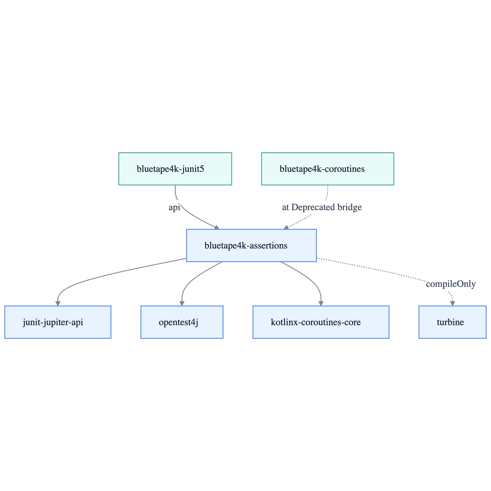

# bluetape4k-assertions

[English](README.md)

JUnit 5 기반의 bluetape4k assertion DSL입니다. 공개 DSL에 필요한 JUnit Jupiter API와 Kotlin coroutines만 api scope로 노출하고, Turbine 연동은 `compileOnly`로 유지합니다.

## 아키텍처



## 기능

- **bluetape4k assertion API 스타일**: 익숙한 infix 함수 이름과 명확한 동등성 의미, 긍정/부정 조건 쌍 제공
- **기본**: `shouldBe` (ref ===), `shouldBeEqualTo` (value ==), `should`/`shouldNot`, `shouldNotBeNull` 스마트 캐스트 지원
- **숫자 비교**: 비교, 부호, 유한수, signed/unsigned 범위 포함 확인
- **컬렉션/배열/맵**: 크기, 내용, 포함, predicate 검증의 긍정/부정 쌍
- **문자열**: 접두사, 접미사, 부분 문자열, 정규식, 대소문자 무시, empty, blank 검증의 긍정/부정 쌍
- **예외**: `invoking { }` / `shouldThrow`, 메시지 검증, 원인 검사
- **비동기 예외**: `coInvoking { }` / `shouldThrow` — CancellationException 안전 coroutine 지원
- **리플렉션**: `shouldBeInstanceOf<T>` 스마트 캐스트 지원
- **날짜시간**: 7가지 java.time 타입의 after/before 및 경계 포함 비교 긍정/부정 쌍
- **Duration**: `java.time.Duration`과 `kotlin.time.Duration`의 양수 및 0 이상 비교 쌍
- **Softly**: `assertSoftly { add { } }` — 가상 스레드 안전, `MultipleFailuresError` 수집
- **Flow 검증**: `assertEmpty`, `assertResult`, `assertResultSet`, `assertFailure`, `assertError`
- **Turbine 통합**: `awaitItemAndAssert`, `awaitItemMatching`, `awaitErrorOfType` (선택사항, compileOnly)

## 빠른 시작

### Gradle 의존성

```kotlin
// build.gradle.kts
testImplementation("io.github.bluetape4k:bluetape4k-assertions:${bluetape4kVersion}")
// 또는 bluetape4k-junit5를 통해 전이적 포함
testImplementation("io.github.bluetape4k:bluetape4k-junit5:${bluetape4kVersion}")
```

### 사용 예시

```kotlin
import io.bluetape4k.assertions.*
import io.bluetape4k.assertions.coroutines.assertEmpty
import io.bluetape4k.assertions.coroutines.assertResult
import kotlinx.coroutines.delay
import kotlinx.coroutines.flow.emptyFlow
import kotlinx.coroutines.flow.flowOf
import kotlinx.coroutines.test.runTest
import org.junit.jupiter.api.Test
import java.time.LocalDateTime
import java.time.Duration as JavaDuration
import kotlin.time.Duration as KotlinDuration
import kotlin.time.Duration.Companion.seconds

class MyTest {
    @Test
    fun `기본 검증`() {
        // 기본
        "hello" shouldBeEqualTo "hello"
        "hello" shouldNotBeEqualTo "world"

        // shouldNotBeNull 후 스마트 캐스트
        val name: String? = "John"
        name.shouldNotBeNull().length shouldBeGreaterThan 0

        // 컬렉션
        listOf(1, 2, 3) shouldContainAll listOf(1, 2)
        listOf(1, 2, 3) shouldNotContainAny listOf(4, 5)
        listOf("GET", "POST") shouldContainIgnoringCase "post"

        // 문자열
        "hello".shouldStartWith("he")
        "hello".shouldEndWith("lo")
        "Hello World" shouldNotContainIgnoringCase "xyz"

        // 숫자 비교
        5 shouldBeLessThan 10
        5 shouldBeGreaterOrEqualTo 5
        5.shouldBePositive()
        (-5).shouldNotBeZero()
        5 shouldBeInRange 1..10
        UInt.MAX_VALUE shouldBeInRange Int.MAX_VALUE.toUInt()..UInt.MAX_VALUE
        5.0.shouldBeNear(5.1, tolerance = 0.2)
        1.0f.shouldBeFinitePositive()
        Float.NaN.shouldNotBePositive() // sign-only 부정 검증은 논리적 부정이다
        Float.POSITIVE_INFINITY.shouldNotBeFinite()

        // Duration
        JavaDuration.ofSeconds(1).shouldBePositive()
        val kotlinDuration: KotlinDuration = 1.seconds
        kotlinDuration.shouldBeZeroOrPositive()

        // 예외
        invoking { error("boom") }.shouldThrow(IllegalStateException::class)

        // 리플렉션
        listOf(1, 2, 3).shouldBeInstanceOf<List<*>>()

        // 날짜시간
        val now = LocalDateTime.now()
        now.shouldBeAfter(now.minusSeconds(1))
        now.shouldBeOnOrBefore(now.plusSeconds(1))
    }

    @Test
    fun `coroutine 검증`() = runTest {
        coInvoking { delay(10) }.shouldNotThrow()
        flowOf(1, 2, 3).assertResult(1, 2, 3)
        emptyFlow<Int>().assertEmpty()
    }

    @Test
    fun `softly 검증`() {
        assertSoftly {
            add { 1 shouldBeEqualTo 1 }
            add { "a" shouldStartWith "a" }
            add { listOf(1) shouldContainAll listOf(1) }
        }
        // 모든 검증 수집, 실패 시 MultipleFailuresError 발생
    }

}
```

## API 레퍼런스

### 기본 검증

| 함수                           | 설명                           |
|--------------------------------|--------------------------------|
| `shouldBe(expected)`           | 참조 동일성 (===)              |
| `shouldNotBe(expected)`        | 참조 다름 (!==)                |
| `shouldBeEqualTo(expected)`    | 값 동등성 (==)                 |
| `shouldNotBeEqualTo(expected)` | 값 다름 (!=)                   |
| `shouldBeNull()`               | null 확인                      |
| `shouldNotBeNull()`            | null 아님 확인 (스마트 캐스트) |
| `should(message, predicate)`   | predicate 조건 확인            |
| `shouldNot(message, predicate)` | predicate 조건의 논리적 부정   |

### 숫자 비교

| 함수                                     | 설명                            |
|------------------------------------------|---------------------------------|
| `shouldBeLessThan(bound)`                | <                               |
| `shouldBeLessOrEqualTo(bound)`           | <=                              |
| `shouldBeGreaterThan(bound)`             | >                               |
| `shouldBeGreaterOrEqualTo(bound)`        | >=                              |
| `shouldBePositive()`                     | > 0                             |
| `shouldNotBePositive()`                  | <= 0 또는 부동소수점 비순서    |
| `shouldBeNegative()`                     | < 0                             |
| `shouldNotBeNegative()`                  | >= 0 또는 부동소수점 비순서    |
| `shouldBeZero()`                         | == 0                            |
| `shouldNotBeZero()`                      | != 0                            |
| `shouldBeFinite()`                       | 유한 `Float`/`Double`           |
| `shouldNotBeFinite()`                    | NaN 또는 무한 `Float`/`Double`  |
| `shouldBeFinitePositive()`              | 유한수이면서 > 0                |
| `shouldNotBeFinitePositive()`           | 유한 양수가 아님                |
| `shouldBeFiniteZeroOrNegative()`        | 유한수이면서 <= 0               |
| `shouldNotBeFiniteZeroOrNegative()`     | 유한 0 이하가 아님              |
| `shouldBeFiniteZeroOrPositive()`       | 유한수이면서 >= 0               |
| `shouldNotBeFiniteZeroOrPositive()`    | 유한 0 이상이 아님              |
| `shouldBeFiniteNegative()`              | 유한수이면서 < 0                |
| `shouldNotBeFiniteNegative()`           | 유한 음수가 아님                |
| `shouldBeInRange(range)`                 | 닫힌 범위 포함 확인             |
| `shouldNotBeInRange(range)`              | 닫힌 범위 미포함 확인           |
| `UInt/ULong shouldBeInRange range`       | unsigned 범위 포함 확인         |
| `UInt/ULong shouldNotBeInRange range`    | unsigned 범위 미포함 확인       |
| `Float/Double shouldBeNear / shouldNotBeNear` | 같은 기본 허용 오차를 사용하는 근사 비교 쌍 |
| `BigDecimal shouldBeNear / shouldNotBeNear` | `BIGDECIMAL_EPSILON`을 사용하는 근사 비교 쌍 |
| `BigDecimal shouldBeEqualTo expected`    | scale 무관 동등 (`compareTo`)   |
| `BigDecimal shouldNotBeEqualTo expected` | scale 무관 비동등 (`compareTo`) |

`Float`/`Double`의 sign-only 검증은 일반 비교 연산자를 사용합니다. 따라서
`NaN`은 `shouldBePositive`, `shouldBeNegative`, `shouldBeZero`에서 실패하고,
각 `shouldNotBe...`에서는 성공합니다. 양의 무한대와 음의 무한대는 일반 부호
검증에서 해당 부호로 통과합니다. `shouldBeFinite...` 계열은 `NaN`과 양·음의
무한대를 모두 거부하며, 유한수 범위에서 두 finite-sign 쌍이 서로 반대입니다.

### Duration

| 함수 쌍 | 설명 |
|---------|------|
| `shouldBePositive()` / `shouldNotBePositive()` | Duration가 `> 0` / `<= 0`인지 확인 |
| `shouldBeZeroOrPositive()` / `shouldBeNegative()` | Duration가 `>= 0` / `< 0`인지 확인 |

`java.time.Duration`과 `kotlin.time.Duration`에 같은 overload를 제공합니다.
Kotlin의 `Duration.INFINITE`와 `-Duration.INFINITE`는 부호에 따라 처리하며,
이 검증은 유한 timeout 여부를 판정하지 않습니다.

### 컬렉션 & 배열

| 함수                                 | 설명                                           |
|--------------------------------------|------------------------------------------------|
| `shouldBeEmpty()`                    | 빈 컬렉션                                      |
| `shouldNotBeEmpty()`                 | 비어있지 않음                                  |
| `shouldContainAll(elements)`         | 모든 요소 포함 (⊇)                             |
| `shouldNotContainAny(elements)`      | 어떤 요소도 미포함 (∩ = ∅)                     |
| `shouldContainAny(elements)`         | 후보 중 하나 이상 포함                         |
| `shouldContainNone(elements)`        | 후보를 모두 미포함; 부정 alias는 `shouldNotContainAny`를 유지하며 `shouldNotContainNone`은 제공하지 않음 |
| `shouldContainAll(elements)` / `shouldNotContainAll(elements)` | 모든 후보 포함 / 하나 이상 미포함 |
| `shouldContainIgnoringCase(element)` | 문자열 컬렉션에서 대소문자 무시 요소 포함      |
| `shouldMatchAllWith(predicate)` / `shouldNotMatchAllWith(predicate)` | 모든 원소가 predicate 만족 / 모두 만족하지는 않음 |
| `shouldMatchAtLeastOneOf(predicate)` / `shouldNotMatchAtLeastOneOf(predicate)` | 하나 이상 만족 / 하나도 만족하지 않음 |
| `shouldHaveSize(size)`               | 크기 확인                                      |
| `shouldNotHaveSize(size)`            | 크기가 다름                                    |
| `shouldContentEqual(expected)` / `shouldNotContentEqual(expected)` | 순서가 같은 내용 동등 / 비동등 |
| `shouldContainSame(expected)` / `shouldNotContainSame(expected)` | 순서와 무관하게 같은 요소 포함 |
| `shouldContain(element)`             | 요소 포함                                      |
| `IntArray shouldBeEqualTo expected`  | primitive 배열 내용 동등 (`contentEquals`)     |
| `ByteArray shouldBeEqualTo expected` | primitive 배열 내용 동등 (`contentEquals`)     |
| `Array<T> shouldBeEqualTo expected`  | 객체 배열 deep 내용 동등 (`contentDeepEquals`) |

크기, 내용, same-content 쌍은 `Iterable`, `Sequence`, `Map`, generic 배열,
primitive 배열의 각 receiver와 인자 overload를 그대로 대칭화합니다. expected가
non-null 배열이면 배열 equality overload가 내용 비교를 사용합니다. expected를
nullable 배열로 선언한 호출은 generic `shouldBeEqualTo` overload를 선택할 수
있으며 이 경우 참조 동등성을 유지합니다. nullable expected의 내용 비교가
필요하면 `shouldContentEqual`을 사용하세요. nullable expected를 받는 content
family는 nullable 반환형 등 기존 receiver 계약을 유지합니다.

### 문자열

| 함수                                      | 설명                                                        |
|-------------------------------------------|-------------------------------------------------------------|
| `shouldContainIgnoringCase(substring)`    | 대소문자를 무시하고 부분 문자열을 포함하는지 확인            |
| `shouldNotContainIgnoringCase(substring)` | 대소문자 무시 미포함; null receiver는 통과하고 null 반환     |
| `shouldContainAll(...)` / `shouldNotContainAll(...)` | 모든 부분 문자열 포함 / 하나 이상 미포함 |
| `shouldContainAny(...)` / `shouldContainNone(...)` | 하나 이상 포함 / 모두 미포함 |
| `shouldMatch(Regex)` / `shouldNotMatch(Regex)` | 정규식 전체 일치 / 불일치 |
| `shouldMatch(String)` / `shouldNotMatch(String)` | 문자열 pattern 일치 / 불일치 |
| `shouldBeEqualToIgnoringCase(value)` / `shouldNotBeEqualToIgnoringCase(value)` | 대소문자 무시 동등 / 비동등 |

### 예외

| 함수                                   | 설명                        |
|----------------------------------------|-----------------------------|
| `invoking { }.shouldThrow(E::class)`   | 동기 블록이 E 예외 발생     |
| `invoking { }.shouldNotThrow()`        | 동기 블록이 예외 미발생     |
| `coInvoking { }.shouldThrow(E::class)` | 비동기 블록이 E 예외 발생   |
| `.withMessage(msg)`                    | 정확한 메시지 일치 (체이닝) |
| `.withMessageContaining(substring)`    | 메시지 부분 포함 (체이닝)   |

### 리플렉션

| 함수                         | 설명                          |
|------------------------------|-------------------------------|
| `shouldBeInstanceOf<T>()`    | 인스턴스 확인 (스마트 캐스트) |
| `shouldNotBeInstanceOf<T>()` | 인스턴스 아님 확인            |

### 날짜시간 비교

`Instant`, `ZonedDateTime`, `OffsetDateTime`, `LocalDateTime`, `LocalDate`,
`LocalTime`, `java.util.Date`는 각각 다음 overload 쌍을 제공합니다.
`shouldBeAfter`/`shouldNotBeAfter`, `shouldBeBefore`/`shouldNotBeBefore`,
`shouldBeOnOrAfter`/`shouldNotBeOnOrAfter`,
`shouldBeOnOrBefore`/`shouldNotBeOnOrBefore`.

### 계약 참고

- 긍정/부정 조건 쌍은 원래 family의 receiver 반환 형태를 유지하며, 기존 API가 nullable을 반환하는 경우 nullable 반환을 유지합니다.
- lazy assertion message와 callback은 필요한 경우에만 평가합니다. Iterable predicate 검증은 원소마다 최대 한 번 평가하며 callback 예외 객체를 그대로 전달합니다.
- `Map.shouldContain(key to value)`는 key 존재 여부와 value equality를 함께 확인해, 없는 key와 `null` 값을 가진 기존 key를 구분합니다.

## 마이그레이션 참고

패키지는 `io.bluetape4k.assertions`를 유지하지만, 동등성 의미는 의도적으로 분리했습니다.

| 기존 기대 동작              | 이 모듈에서 사용할 함수              | 주의사항                 |
|-----------------------------|--------------------------------------|--------------------------|
| `shouldBe`로 값 동등성 확인 | `shouldBeEqualTo`                    | 구조적 동등성(`==`) 확인 |
| `shouldBe` (ref ===)        | `shouldBe`                           | 동일한 동작              |
| `shouldNotBeNull()`         | `shouldNotBeNull()`                  | + 스마트 캐스트 지원     |
| `shouldThrow(E::class)`     | `invoking { }.shouldThrow(E::class)` | 명시적 블록 래퍼         |
| `shouldHaveMessage()`       | `.withMessage()`                     | InvokingBlock에서 체이닝 |
| `coInvoking { }`            | `coInvoking { }`                     | 완전한 coroutine 지원    |

### 중요한 의미 변화

**이 모듈의 `shouldBe`는 `===` (참조 동일성)를 사용합니다.**
**`==` (값 동등성) 검증에는 `shouldBeEqualTo`를 사용하세요.**

이 분리는 의도적인 설계입니다. 테스트에서 값 동등성과 객체 동일성을 한 함수 이름에 의존하지 않고 명확히 구분할 수 있습니다.

```kotlin
// 구조적 동등성
"a" shouldBeEqualTo "a"  // 통과 (== 비교)

// 이 모듈
"a" shouldBe "a"  // 실패! (=== 비교)
"a" shouldBeEqualTo "a"  // 통과 (== 비교)
```

---

**유지보수자**: Sunghyouk Bae (@sunghyouk.bae@gmail.com)
**라이선스**: MIT
